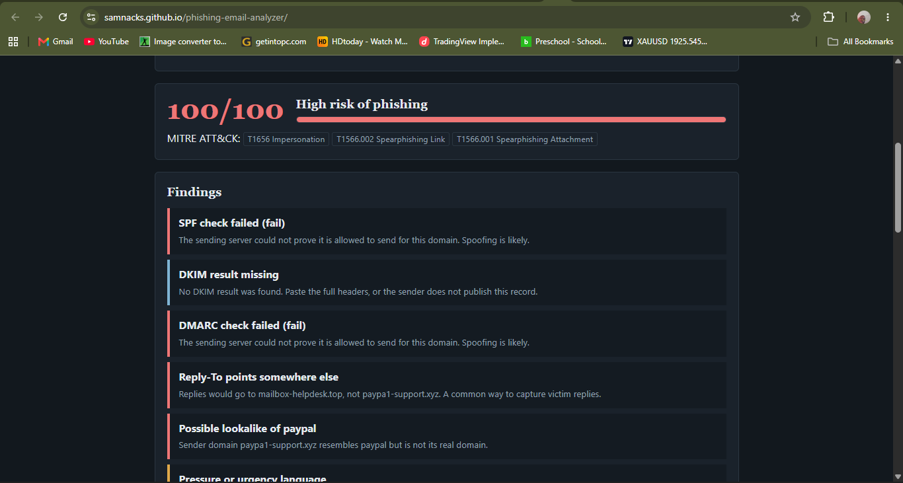

Phishing Email Analyzer

A lightweight, browser-based tool that helps investigate suspicious emails.
Paste the raw email source or open a .eml file, and the analyzer explains who
the message claims to be, where it actually came from, and what looks wrong.

Live demo : https://samnacks.github.io/phishing-email-analyzer/

 Features
- Parses email headers and checks SPF, DKIM and DMARC results
- Detects sender spoofing (From vs Reply-To vs Return-Path mismatches,
  misleading display names, lookalike brand domains)
- Extracts and analyzes links: raw IPs, URL shorteners, punycode,
  suspicious TLDs, and link text that doesn't match the real destination
- Flags risky attachments, including double extensions like invoice.pdf.exe
- Traces the delivery path through Received headers
- Produces a 0-100 risk score with plain-English findings
- Maps findings to MITRE ATT&CK (T1566.001, T1566.002, T1656)
- Defangs links so they can't be clicked by accident
- Exports a copyable text report

Privacy
Everything runs locally in your browser. No email content is uploaded,
stored or sent to any server.

How it works
The tool parses headers and body in JavaScript, applies weighted detection
rules, and sums the results into a capped risk score. Each rule adds a
finding that explains why it fired.

Limitations
- Heuristic scoring, not a replacement for a commercial email security product
- Does not query live threat intelligence or reputation services
- Does not decode every MIME encoding or nested attachment type
- Authentication results depend on the headers present in the pasted source

Disclaimer
For education and defensive analysis only.
